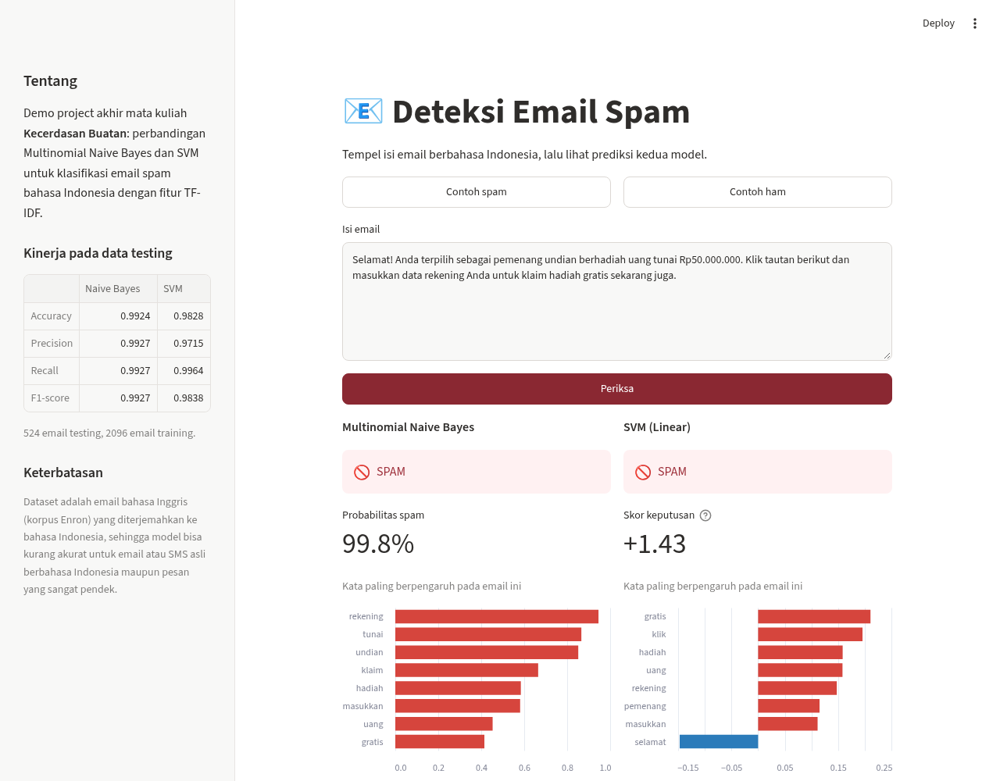
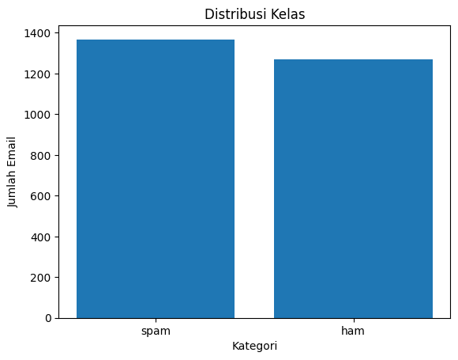
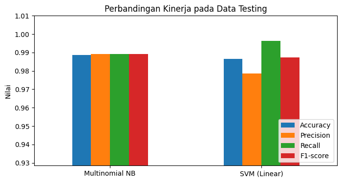
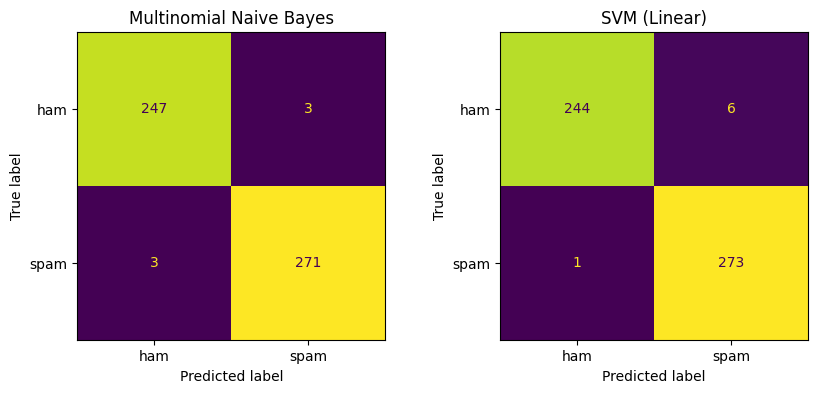
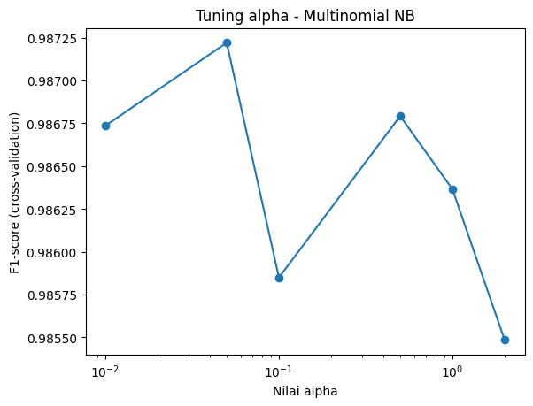
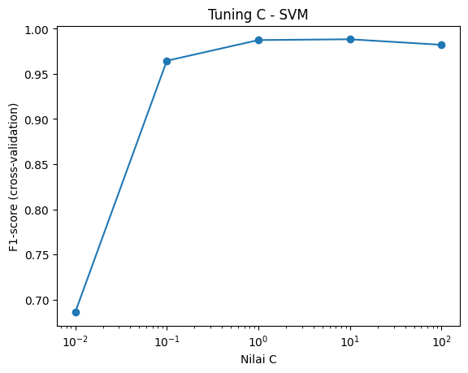
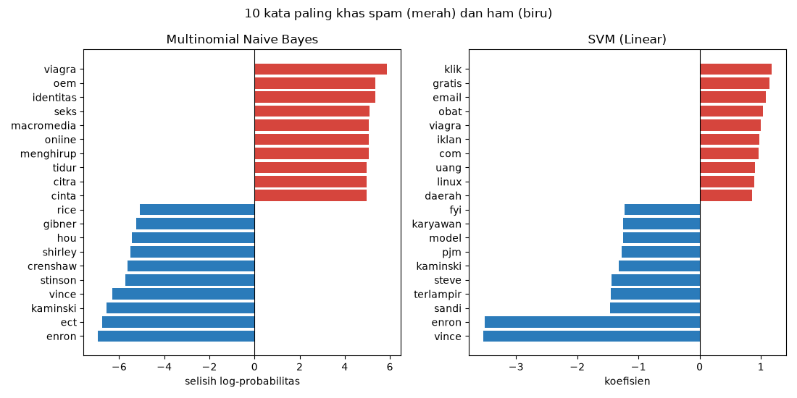

# Klasifikasi Email Spam Bahasa Indonesia

[](https://colab.research.google.com/github/LuqmanSyah/project-kecerdasan-buatan/blob/main/Klasifikasi_Email_Spam_NB_SVM.ipynb)

Project akhir mata kuliah **Kecerdasan Buatan**: perbandingan **Multinomial Naive Bayes** dan **Support Vector Machine (SVM, kernel linear)** untuk mengklasifikasikan email berbahasa Indonesia menjadi **spam** atau **ham** (bukan spam), dengan fitur **TF-IDF**.

Project ini terdiri dari dua bagian:

- **Notebook** ([Klasifikasi_Email_Spam_NB_SVM.ipynb](Klasifikasi_Email_Spam_NB_SVM.ipynb)): seluruh eksperimen, mulai dari EDA, prapemrosesan, training, evaluasi, tuning, hingga analisis.
- **Aplikasi demo** ([app.py](app.py)): aplikasi web Streamlit untuk mencoba kedua model secara langsung.

## Demo Aplikasi



Tempel isi email, lalu aplikasi menampilkan:

- prediksi **spam/ham** dari kedua model secara berdampingan,
- **probabilitas spam** (Naive Bayes) dan **skor keputusan** (SVM; positif berarti spam, negatif berarti ham),
- **kata yang paling berpengaruh** pada email tersebut (merah mendorong ke spam, biru ke ham), sehingga alasan di balik prediksi bisa dilihat.

Langkah menjalankannya ada di bagian [Cara Menjalankan → Aplikasi demo](#aplikasi-demo).

## Dataset

[Indonesian Email Spam](https://www.kaggle.com/datasets/gevabriel/indonesian-email-spam) (Kaggle, Gevabriel), dengan dua kolom: `Kategori` (spam/ham) dan `Pesan`.

| | Jumlah |
|---|---|
| Data awal | 2.636 |
| Setelah buang duplikat | 2.620 |
| Spam (label 1) | 1.368 |
| Ham (label 0) | 1.252 |

Data dibagi menjadi 80% training (2.096) dan 20% testing (524) dengan stratifikasi.



## Tahapan

1. **EDA**: distribusi kelas, nilai kosong, duplikat, dan panjang teks.
2. **Pembersihan data**: duplikat dibuang *sebelum* split supaya tidak terjadi kebocoran data.
3. **Prapemrosesan teks**: case folding, hapus URL/email/angka/tanda baca, stopword removal, dan stemming (Sastrawi).
4. **Ekstraksi fitur**: TF-IDF (`min_df=2`, `max_df=0.95`, `sublinear_tf=True`), di-fit hanya pada data training.
5. **Training dan evaluasi**: accuracy, precision, recall, F1-score, dan confusion matrix.
6. **5-fold stratified cross-validation**: TF-IDF dimasukkan ke dalam `Pipeline` sehingga dihitung ulang di setiap fold.
7. **Hyperparameter tuning**: `alpha` untuk Naive Bayes dan `C` untuk SVM, dipilih berdasarkan F1-score CV pada data training.
8. **Eksperimen tambahan**: pengaruh stemming dan bigram.
9. **Analisis**: kesalahan prediksi dan kata yang paling berpengaruh.
10. **Prediksi email baru dan penyimpanan model** (`.pkl`).

## Hasil Utama

Data testing (524 email), kelas spam sebagai kelas positif:

| Model | Parameter | Accuracy | Precision | Recall | F1-score |
|---|---|---|---|---|---|
| Multinomial NB | alpha = 1.0 | 0,9885 | 0,9891 | 0,9891 | 0,9891 |
| Multinomial NB (tuning) | alpha = 0.05 | **0,9924** | **0,9927** | 0,9927 | **0,9927** |
| SVM Linear | C = 1 | 0,9866 | 0,9785 | **0,9964** | 0,9873 |
| SVM Linear (tuning) | C = 10 | 0,9828 | 0,9715 | **0,9964** | 0,9838 |

5-fold cross-validation pada data training (rata-rata ± std):

| Model | Accuracy | F1-score |
|---|---|---|
| Multinomial NB | 0,9857 ± 0,0050 | 0,9864 ± 0,0047 |
| SVM Linear | 0,9866 ± 0,0056 | 0,9873 ± 0,0052 |

Kedua model sama-sama mencapai akurasi sekitar 98–99%. Selisihnya kecil (beberapa email dari 524) dan masih di dalam rentang standar deviasi CV. Detail lengkap, termasuk pengaruh stemming/bigram dan analisis kesalahan, ada di notebook.

**Perbandingan kinerja dan confusion matrix** (parameter awal, sebelum tuning):





**Hyperparameter tuning** dengan F1-score 5-fold CV pada data training:

<p>
  
  
</p>

**Kata yang paling berpengaruh** pada model final:



Kata khas spam masuk akal (*viagra*, *gratis*, *klik*, *obat*, *uang*). Sebaliknya, kata khas ham didominasi nama orang dan perusahaan dari korpus Enron (*enron*, *vince*, *kaminski*), karena dataset ini merupakan terjemahan email Enron. Akibatnya model bisa kurang akurat untuk email Indonesia asli yang tidak mengandung nama-nama tersebut.

## Cara Menjalankan

### Notebook

**Google Colab (disarankan):** klik badge *Open in Colab* di atas, lalu jalankan semua sel (*Runtime → Run all*). Dataset diunduh otomatis lewat `kagglehub`.

**Lokal:**

```bash
pip install kagglehub PySastrawi scikit-learn pandas numpy matplotlib joblib jupyter
jupyter notebook Klasifikasi_Email_Spam_NB_SVM.ipynb
```

Proses stemming memakan waktu beberapa menit.

### Aplikasi demo

Disarankan memakai **virtual environment (venv)** supaya library project ini tidak tercampur dengan library Python lain di komputer. Sudah diuji dengan Python 3.12.

**1. Clone repository**

```bash
git clone https://github.com/LuqmanSyah/project-kecerdasan-buatan.git
cd project-kecerdasan-buatan
```

**2. Buat virtual environment** (cukup sekali)

```bash
python -m venv .venv
```

Di Linux/macOS, jika perintah `python` tidak ditemukan, gunakan `python3`.

**3. Aktifkan virtual environment** (setiap kali membuka terminal baru)

| Sistem operasi | Perintah |
|---|---|
| Linux / macOS | `source .venv/bin/activate` |
| Windows (Command Prompt) | `.venv\Scripts\activate.bat` |
| Windows (PowerShell) | `.venv\Scripts\Activate.ps1` |

Jika berhasil, muncul tulisan `(.venv)` di awal baris terminal.

> Di PowerShell, jika muncul error *running scripts is disabled*, jalankan dulu `Set-ExecutionPolicy -Scope CurrentUser RemoteSigned`, lalu ulangi perintah aktivasi.

**4. Install library** (cukup sekali)

```bash
pip install -r requirements.txt
```

**5. Jalankan aplikasi**

```bash
streamlit run app.py
```

Aplikasi terbuka otomatis di browser, atau buka http://localhost:8501. Tekan `Ctrl+C` di terminal untuk menghentikannya, dan ketik `deactivate` untuk keluar dari virtual environment.

Model yang sudah dilatih tersedia di folder [models/](models/), jadi aplikasi bisa langsung dijalankan. Untuk melatih ulang model (dataset diunduh otomatis dari Kaggle), jalankan perintah berikut dengan venv dalam keadaan aktif:

```bash
python train.py
```

`train.py` memakai langkah dan parameter yang sama dengan model final di notebook (tanpa stemming, unigram, `alpha=0.05`, `C=10`), sehingga hasilnya identik dengan bagian *Evaluasi Model Setelah Tuning*.

## Memakai Model di Kode Lain

Setiap file `.pkl` berisi pipeline TF-IDF dan model. Teks baru harus melewati prapemrosesan yang sama sebelum diprediksi:

```python
import joblib
from preprocessing import siapkan_teks

model = joblib.load("models/naive_bayes.pkl")
model.predict([siapkan_teks("Selamat! Anda memenangkan hadiah, klik tautan ini.")])  # 1 = spam, 0 = ham
```

## Struktur Repository

```
.
├── Klasifikasi_Email_Spam_NB_SVM.ipynb   # notebook eksperimen utama
├── app.py                                # aplikasi demo Streamlit
├── train.py                              # melatih ulang dan menyimpan model final
├── preprocessing.py                      # fungsi prapemrosesan teks (dipakai app.py dan train.py)
├── models/
│   ├── naive_bayes.pkl
│   ├── svm.pkl
│   └── metrik.json                       # hasil evaluasi pada data testing
├── images/                               # grafik untuk README
├── requirements.txt
└── README.md
```

## Teknologi

Python, scikit-learn, PySastrawi, pandas, NumPy, Matplotlib, Streamlit, Altair, kagglehub.
